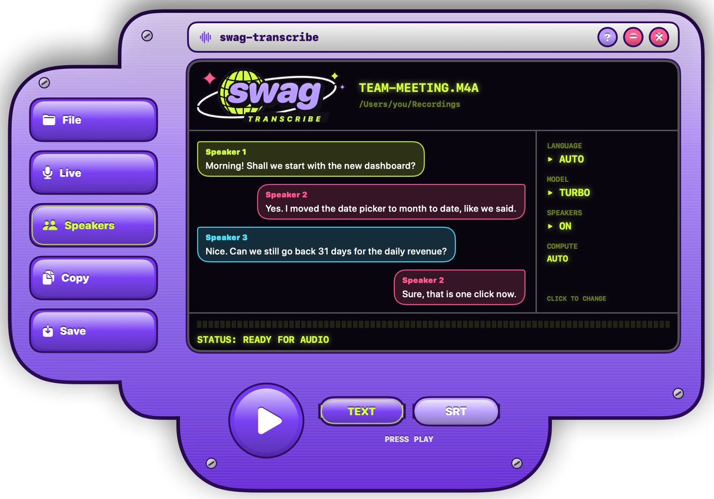
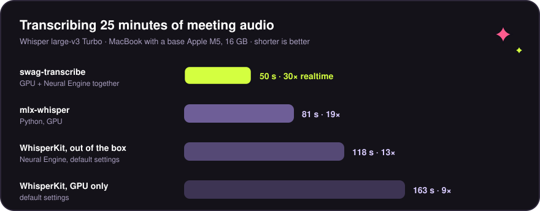
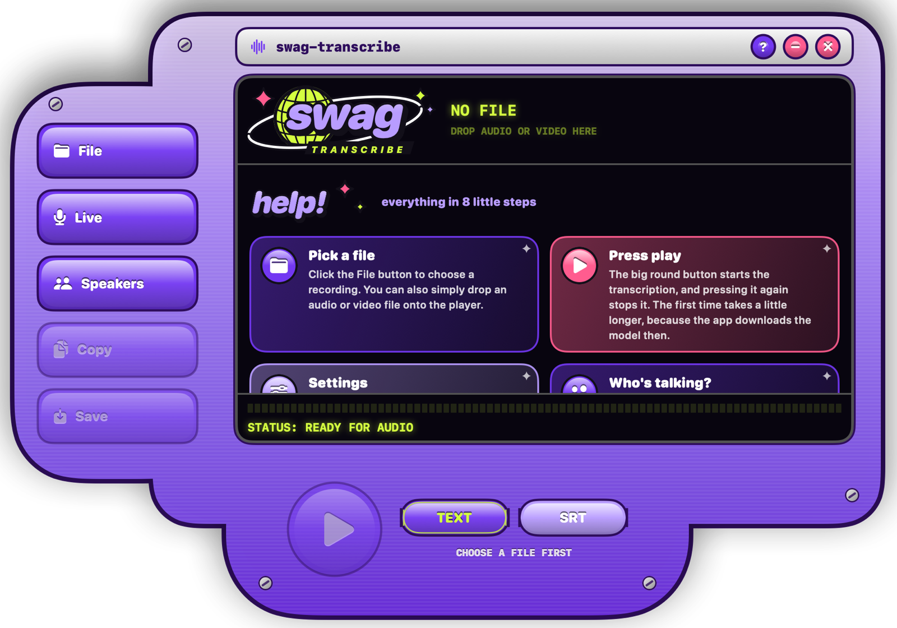
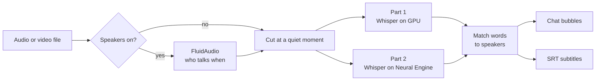

<p align="center">
  
</p>

<p align="center">
  <b>Turn recordings into text on your Mac. Fast, private, and dressed like it's 2003.</b>
</p>

<p align="center">
  
  
  
  
  
</p>

<p align="center">
  
</p>

swag-transcribe runs OpenAI's Whisper on your own Mac with [WhisperKit](https://github.com/argmaxinc/WhisperKit),
figures out who is talking with [FluidAudio](https://github.com/FluidInference/FluidAudio), and shows the result as
a colorful group chat. Your audio never leaves the machine.

## ✦ Highlights

|  |  |
|---|---|
| ⚡ **30× realtime** | 25 minutes of audio in 50 seconds on a base M5 MacBook, by running the GPU and the Neural Engine at the same time. |
| 💬 **Who said what** | Speaker recognition at word level, shown as chat bubbles with one color per speaker. |
| 🎬 **Subtitles included** | Export plain text, or SRT subtitles with timestamps for YouTube, Premiere, CapCut or VLC. |
| 🎙️ **Live mode** | Talk and watch your words appear, using Apple's on-device speech recognition. |
| ⏱️ **Honest countdown** | Learns how fast your Mac is and tells you how long a file will take, within a few percent. |
| 🔒 **Private** | No accounts, no uploads, no cloud. Only the models are downloaded, once. |
| 🌍 **English and Dutch** | The interface follows the language of your Mac. |

## ⚡ Speed

<p align="center">
  
</p>

Every setup transcribed the same 25-minute Dutch meeting with the same model, Whisper large-v3 Turbo, on a base
M5 MacBook with 16 GB of RAM. Times include loading the model.

| Setup | Time | Speed | Peak memory |
|---|---:|---:|---:|
| **swag-transcribe** | **50 s** | **30× realtime** | **1.3 GB** |
| mlx-whisper, Python on the GPU | 81 s | 19× | 0.9 GB |
| WhisperKit with default settings, Neural Engine | 118 s | 13× | 0.75 GB |
| WhisperKit with default settings, GPU only | 163 s | 9× | 4.0 GB |

Turning on speaker recognition adds about 17 seconds for the same file.

### How it got from 118 to 50 seconds

| Step | Time | What changed |
|---|---:|---|
| WhisperKit out of the box | 118 s | Starting point |
| Stop wasting work | 81 s | Whisper re-decoded almost every window of Dutch audio because one threshold was too strict. Turning it off also gave 13% more words. |
| Decoder on the GPU | 61 s | The Neural Engine runs parallel decoders one at a time; the GPU runs them together. |
| Both chips at once | 50 s | The audio is split at a quiet moment. One half runs on the GPU, the other on the Neural Engine, at the same time. |

Not every Mac is built the same. A Pro or Max chip has a much bigger GPU but the same Neural Engine. So the first
time you transcribe, swag-transcribe times every option on two minutes of your file and keeps the winner.

## 🚀 Get started

You need an Apple Silicon Mac with macOS 15 or later and Xcode or the Xcode Command Line Tools.

```sh
git clone https://github.com/Ykingdev/swag-transcribe.git
cd swag-transcribe
./build.sh
open swag-transcribe.app
```

The first build fetches and compiles the Swift packages, which takes a few minutes. The first transcription
downloads the Turbo model (about 1.5 GB) and tunes itself to your Mac, which adds about half a minute once.

## 🎛️ Using it

<p align="center">
  
</p>

1. Click **File**, or drop an audio or video file onto the player.
2. Click the settings on the right of the screen to pick a language, a model or speaker recognition.
3. Press the big round **play** button. Press it again to stop.
4. Read the result as **Text** or **SRT**, then **Copy** or **Save** it.

Move the window by dragging the chrome title bar or the purple frame. The **?** button opens the help page above.

| Model | Download | Best for |
|---|---:|---|
| Turbo | 1.5 GB | Everyday use. Fast and very accurate. |
| Large-v3 | 1.5 GB | Difficult audio, when every word counts. About 1.4 times slower on an M5. |

## 🧠 How it works



<details>
<summary><b>The design decisions, in detail</b></summary>

<br>

**Native instead of Python.** The first version called mlx-whisper from a Python environment. WhisperKit and
FluidAudio make it one self-contained app that uses the Neural Engine and needs no setup.

**Memory is not the bottleneck.** Most of the time goes into the decoder, which writes text one token at a time.
Each token takes about 8.7 ms, almost all of it call overhead rather than math. A smaller quantized model
(632 MB instead of 1.5 GB) was not faster, because the Neural Engine expands the weights to 16-bit anyway.

**The first-token threshold is off.** WhisperKit re-decodes a 30-second window at a higher temperature when the
first token looks unlikely. On Dutch meetings that fired 84 times for 73 windows. Turning it off made
transcription 31% faster, gave 13% more words, and flagged zero segments as repetitive or unsure. The thresholds
for repetition and average probability stay on. Turning the probability threshold off as well let garbled and
repeated lines through.

**Fewer tasks than CPU cores.** WhisperKit's sampler blocks one Swift concurrency thread per task, and Swift has
one such thread per CPU core. Two pipelines with 16 tasks each deadlocked a 10-core M5. The app uses the core
count minus two, split over the pipelines. 8, 16 and 32 tasks measured equally fast.

**Speakers at word level.** Speaker turns are matched to Whisper's word timestamps, so a change of speaker in the
middle of a sentence lands in the right place. A word in a silence between two turns goes to the nearest
speaker. The clustering threshold of 0.6 found exactly four speakers on a four-speaker test, where 0.7 merged
them into two.

**A countdown that learns.** After every file longer than a minute, the app stores how many seconds of work one
second of audio took, per model and with or without speakers. During a run it counts finished chunks, because
WhisperKit reports times relative to each chunk. The countdown starts from the learned estimate and hands over to
the measured pace by 50% progress. Short runs keep the learned estimate, because chunks finish in waves.

**Two languages in code.** With exactly two languages, a small `localized(english, dutch)` function is simpler
than a String Catalog, which would need a resource bundle next to the hand-built app. System dialogs and
permission prompts are still translated through `en.lproj` and `nl.lproj`.

</details>

<details>
<summary><b>Project layout</b></summary>

<br>

| File | What it holds |
|---|---|
| `SwagTranscribeApp.swift` | App entry, plus the headless `--cli` and `--render` modes |
| `Transcriber.swift` | Diarization, model loading, the compute benchmark, progress and countdown |
| `Formatting.swift` | Pure functions: SRT timestamps, quiet-point search, speaker matching, transcript layout |
| `Settings.swift` | Models, compute paths, interface language, stored settings, environment overrides |
| `WaitTime.swift` | Learned speed per Mac, duration formatting, things to do while waiting |
| `LiveTranscriber.swift` | Microphone transcription with Apple's Speech framework |
| `ContentView.swift` | The player layout and its actions |
| `ChatTranscript.swift` | Speaker turns as chat bubbles |
| `HelpView.swift` | The help page |
| `Skin.swift` | Chassis, glossy buttons, LCD text, progress bar, marquee, speaker colors, window setup |
| `Logo.swift` | Logo and app icon, drawn in SwiftUI |

</details>

<details>
<summary><b>Development</b></summary>

<br>

```sh
swift build                                        # debug build
swift test                                         # unit tests
swift format lint -r Sources Tests Package.swift   # style check, settings in .swift-format
```

**Headless modes**

```sh
APP=swag-transcribe.app/Contents/MacOS/SwagTranscribe
$APP --cli recording.m4a --speakers   # status, countdown, text, SRT, decode stats and timings
$APP --render player docs/player.png  # icon | logo | ui | help | player
```

Add `-AppleLanguages "(nl)"` to render the Dutch interface.

**Environment overrides for benchmarking**

| Variable | Effect |
|---|---|
| `WHISPER_COMPUTE` | Force a compute path: `gpu`, `ane`, `mix` or `dual` |
| `WHISPER_MODEL` | Any variant name from `argmaxinc/whisperkit-coreml` |
| `WHISPER_LANG` | Spoken language for `--cli`, for example `nl` |
| `WHISPER_SPLIT` | Share of the audio for the GPU half in `dual`, for example `0.55` |
| `WHISPER_WORKERS` | Concurrent tasks per run |
| `WHISPER_FALLBACKS` | Number of temperature fallbacks |
| `WHISPER_FIRSTTOKEN`, `WHISPER_LOGPROB`, `WHISPER_COMPRESSION` | Decoding thresholds, a number or `none` |
| `WHISPER_CHUNKING` | `none` to turn off voice-activity chunking |
| `DIARIZER_THRESHOLD` | Speaker clustering; lower finds more speakers |

**Stored settings**

```sh
defaults read dev.webads.swag-transcribe              # benchmark winner, split and learned speeds
defaults delete dev.webads.swag-transcribe compute    # benchmark again on the next file
```

Models are stored in `~/Documents/huggingface/models/argmaxinc/whisperkit-coreml/`, speaker models in FluidAudio's
folder in `~/Library/Application Support/`.

</details>

## 🛣️ Ideas for later

- **A decoder made for the Neural Engine.** Keeping the decoder's memory on the chip and decoding several windows
  per call would attack the 8.7 ms per-token overhead directly. Estimated 3 to 5 times faster decoding.
- **Fine-tuning on Dutch**, so the model is more confident on Dutch meetings and makes fewer mistakes.
- **Speaker labels in live mode**, which needs streaming speaker recognition.

## License

MIT, see [LICENSE](LICENSE).
